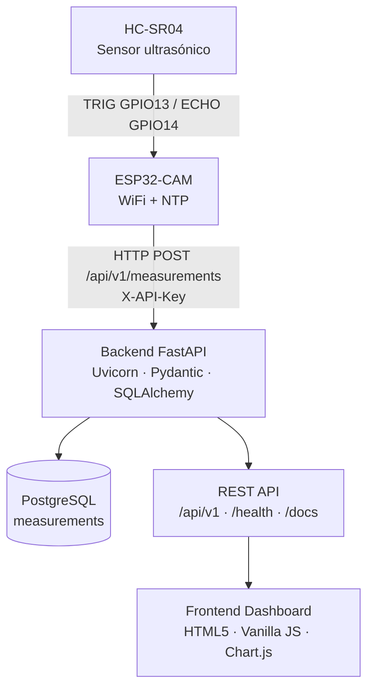
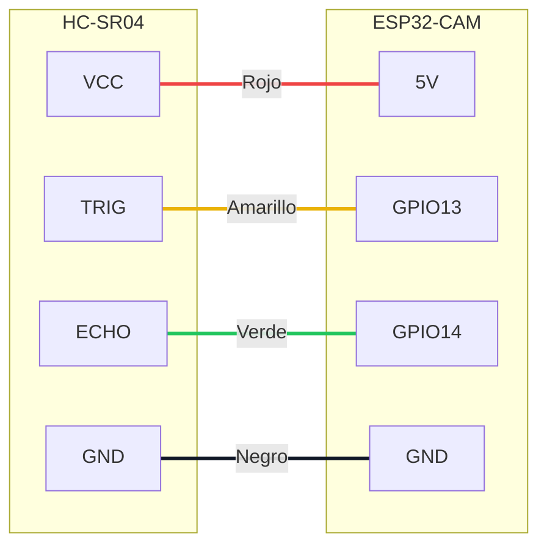

<div align="center">

# 📡 ESP32 Distance Monitoring System

**Sistema IoT de monitoreo de distancias basado en ESP32-CAM y HC-SR04 con sincronización NTP y transmisión WiFi.**


[Arquitectura](#-arquitectura) · [Hardware](#-hardware-utilizado) · [Instalación](#-instalación) · [Despliegue](#-despliegue) · [API](api/README.md) · [Roadmap](#-roadmap)

</div>

---

## 📖 Introducción

**ESP32 Distance Monitoring System** es una solución IoT de extremo a extremo que captura mediciones de distancia con un sensor ultrasónico **HC-SR04** conectado a una **ESP32-CAM AI Thinker**, las marca temporalmente mediante **NTP** y las transmite por **WiFi** a un backend **FastAPI** que las persiste en **PostgreSQL** y las expone a través de una **API REST** consumida por un **dashboard web** ligero.

El dispositivo realiza una lectura cada **30 segundos**:

```
2026-11-01 11:08:55 | Distancia: 214.05 cm
2026-11-01 11:09:25 | Distancia: 4.92 cm
```

El proyecto está diseñado como base extensible para integrar **MQTT**, actuadores (**servo SG90**), captura de imágenes con la **cámara de la ESP32-CAM** y **visión artificial** con modelos de **Hugging Face**.

## 🎯 Objetivos

**General:** implementar un sistema IoT funcional para la adquisición, almacenamiento y visualización de mediciones de distancia en tiempo casi real.

**Específicos:**

1. Adquirir mediciones del HC-SR04 con la ESP32-CAM y marcarlas con hora real sincronizada por NTP.
2. Transmitir las mediciones por HTTP a una API REST segura con API Key.
3. Persistir el histórico en PostgreSQL con migraciones versionadas (Alembic).
4. Visualizar distancia actual, histórico, gráfico temporal y estado del dispositivo en un dashboard responsive.
5. Desplegar la solución en servicios gratuitos (Render + GitHub Pages).
6. Dejar preparada la arquitectura para MQTT, servo, cámara e IA.

## 🏗 Arquitectura



| Capa | Tecnología | Hosting |
|------|-----------|---------|
| Borde | ESP32-CAM AI Thinker + HC-SR04 (Arduino) | Red WiFi doméstica |
| Backend | Python 3.12+, FastAPI, SQLAlchemy 2, Pydantic 2, Alembic, Uvicorn | Render (alt. Railway, Fly.io) |
| Datos | PostgreSQL 16 | Render PostgreSQL (alt. Neon, Supabase) |
| Frontend | HTML5, CSS3, Vanilla JavaScript, Chart.js | GitHub Pages |
| Documentación | Markdown + Mermaid.js | GitHub |

📐 Más diagramas: [arquitectura general](diagrams/01-arquitectura-general.md) · [flujo de datos](diagrams/02-flujo-datos.md) · [hardware](diagrams/03-conexion-hardware.md) · [flujo HTTP](diagrams/04-flujo-http.md) · [pipeline IA](diagrams/05-pipeline-ia.md) · [modelo de datos](diagrams/06-modelo-datos.md)

## 🔧 Hardware utilizado

| Componente | Función |
|-----------|---------|
| **ESP32-CAM AI Thinker** | Microcontrolador con WiFi, cámara OV2640 y PSRAM. |
| **ESP32-CAM-MB** | Programador USB-serie (CH340) y alimentación. |
| **HC-SR04** | Sensor ultrasónico de distancia (2–400 cm). |
| **Cable Micro-USB de datos** | Programación y alimentación. |
| **Red WiFi 2.4 GHz** | Conectividad a Internet / red local. |

Detalle técnico: [docs/hardware.md](docs/hardware.md).

## 🔌 Esquema de conexiones

| HC-SR04 | ESP32-CAM | Cable |
|---------|-----------|-------|
| VCC | 5V | 🔴 Rojo |
| GND | GND | ⚫ Negro |
| TRIG | GPIO13 | 🟡 Amarillo |
| ECHO | GPIO14 | 🟢 Verde |



> ⚠️ ECHO entrega 5 V y los GPIO del ESP32 son de 3.3 V. Se recomienda un divisor resistivo 1 kΩ / 2 kΩ — ver [consideraciones eléctricas](docs/hardware.md#4-consideraciones-eléctricas).

## 📁 Estructura del repositorio

```
/
├── README.md                 # Este documento
├── render.yaml               # Blueprint de Render (backend + PostgreSQL)
├── .github/workflows/        # CI del backend y despliegue en GitHub Pages
├── docs/                     # Documentación técnica
├── frontend/                 # Dashboard HTML5 + Vanilla JS + Chart.js
├── backend/                  # API FastAPI, modelos, migraciones y pruebas
│   ├── app/                  #   Código de la aplicación
│   ├── alembic/              #   Migraciones
│   ├── scripts/              #   Simulador de dispositivo, exportación OpenAPI
│   └── tests/                #   Pruebas (pytest)
├── api/                      # Referencia de la API, OpenAPI y ejemplos
├── diagrams/                 # Diagramas Mermaid
├── deployment/               # Render, Railway, Fly.io, Docker y GitHub Pages
└── firmware/                 # Contrato de integración del firmware ESP32
```

## ⚙ Instalación

### Requisitos

- Python **3.12+**
- PostgreSQL **14+** o Docker Desktop
- Git

### Inicio rápido con Docker

```bash
git clone https://github.com/jose-i-rm/esp32-distance-monitoring-system.git
cd esp32-distance-monitoring-system/deployment/docker
cp .env.example .env
docker compose up --build
```

- Dashboard: http://localhost:5500
- API (Swagger): http://localhost:8000/docs

### Inicio manual

```bash
cd backend
python -m venv .venv
source .venv/bin/activate          # Windows: .\.venv\Scripts\Activate.ps1
pip install -r requirements-dev.txt
cp .env.example .env               # Ajuste DATABASE_URL y DEVICE_API_KEY
alembic upgrade head
uvicorn app.main:app --reload --host 0.0.0.0 --port 8000

# En otra terminal
cd frontend && python -m http.server 5500
```

### Enviar datos

- **Desde la ESP32-CAM:** `POST http://<IP_DEL_PC>:8000/api/v1/measurements` con cabecera `X-API-Key` — ver [firmware/README.md](firmware/README.md).
- **Sin hardware:** `python backend/scripts/simulate_device.py --api-key <KEY> --interval 5`.

### Pruebas

```bash
cd backend && pytest -q
```

Guía completa: [docs/instalacion.md](docs/instalacion.md).

## 🌐 API REST

| Método | Endpoint | Descripción |
|--------|----------|-------------|
| `POST` | `/api/v1/measurements` | Registrar medición (requiere `X-API-Key`) |
| `GET` | `/api/v1/measurements` | Historial paginado (`limit`, `offset`, `start`, `end`) |
| `GET` | `/api/v1/measurements/latest` | Última medición |
| `GET` | `/health` | Estado del servicio y de la base de datos |

```json
POST /api/v1/measurements
{ "timestamp": "2026-11-01T11:08:55-05:00", "distance_cm": 214.05 }
```

Referencia completa: [api/README.md](api/README.md) · [OpenAPI](api/openapi.json).

## 🚀 Despliegue

| Componente | Plataforma | Guía |
|-----------|-----------|------|
| Backend + PostgreSQL | **Render** (Blueprint `render.yaml`) | [deployment/render](deployment/render/README.md) |
| Backend (alternativas) | Railway · Fly.io | [railway](deployment/railway/README.md) · [fly](deployment/fly/README.md) |
| Frontend | **GitHub Pages** (GitHub Actions) | [deployment/github-pages.md](deployment/github-pages.md) |

1. Render → **New → Blueprint** → seleccionar este repositorio.
2. Copiar la URL pública y la `DEVICE_API_KEY` generada.
3. GitHub → *Settings → Variables* → `API_BASE_URL` = URL de Render.
4. GitHub → *Settings → Pages* → *Source: GitHub Actions*.
5. Configurar la URL y la API Key en el firmware.

🔐 **Credenciales pendientes:** [docs/credenciales-pendientes.md](docs/credenciales-pendientes.md).

## 🗺 Roadmap

| Fase | Alcance | Estado |
|------|---------|--------|
| 1 | Firmware: WiFi + NTP + HC-SR04 cada 30 s | ✅ Completado |
| 2 | Backend FastAPI + PostgreSQL + API REST + Dashboard | ✅ Completado |
| 3 | Despliegue Render + GitHub Pages | 🔄 Pendiente de credenciales |
| 4 | MQTT (broker, LWT, comandos bidireccionales) | 📋 Planificado |
| 5 | Servo SG90 para barrido angular | 📋 Planificado |
| 6 | Captura de imágenes con ESP32-CAM | 📋 Planificado |
| 7 | Visión artificial con Hugging Face | 📋 Planificado |

## 🔮 Futuras mejoras

- **MQTT** con Mosquitto/HiveMQ para comunicación bidireccional y menor consumo.
- **Servo SG90** para orientar el sensor y generar mapas polares de distancia.
- **Cámara ESP32-CAM** para capturar imágenes al detectar objetos cercanos.
- **IA con Hugging Face:** `ESP32-CAM → captura → FastAPI → Hugging Face → clasificación → dashboard`.
- Gestión multi-dispositivo, alertas por umbral (Telegram/correo) y tiempo real con SSE/WebSockets.

Detalles: [docs/futuras-integraciones.md](docs/futuras-integraciones.md) · [diagrams/05-pipeline-ia.md](diagrams/05-pipeline-ia.md).

## 📚 Documentación

| Documento | Descripción |
|-----------|-------------|
| [docs/arquitectura.md](docs/arquitectura.md) | Arquitectura, decisiones de diseño y seguridad |
| [docs/hardware.md](docs/hardware.md) | Componentes, conexiones y consideraciones eléctricas |
| [docs/instalacion.md](docs/instalacion.md) | Instalación local paso a paso |
| [docs/base-de-datos.md](docs/base-de-datos.md) | Esquema, migraciones y consultas |
| [docs/frontend.md](docs/frontend.md) | Dashboard y configuración |
| [docs/solucion-de-problemas.md](docs/solucion-de-problemas.md) | Errores frecuentes |

## 📄 Licencia

Distribuido bajo la licencia **MIT**. Consulte [LICENSE](LICENSE).
