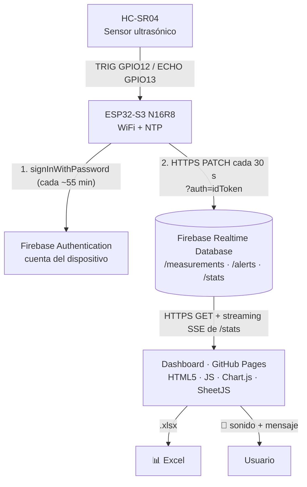
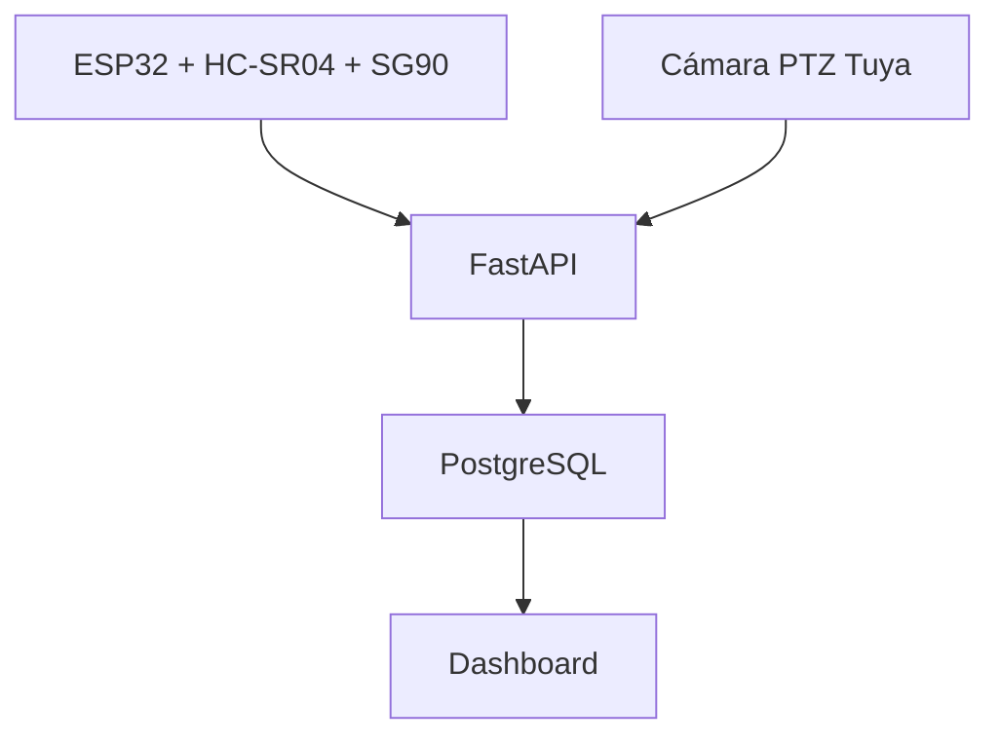
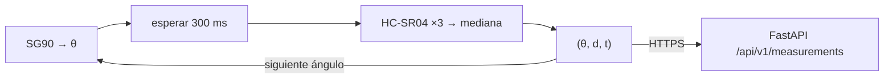
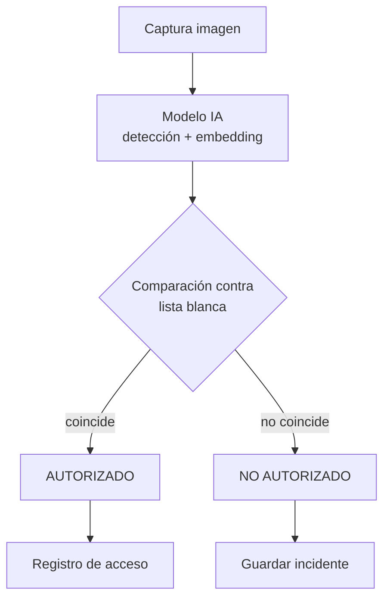
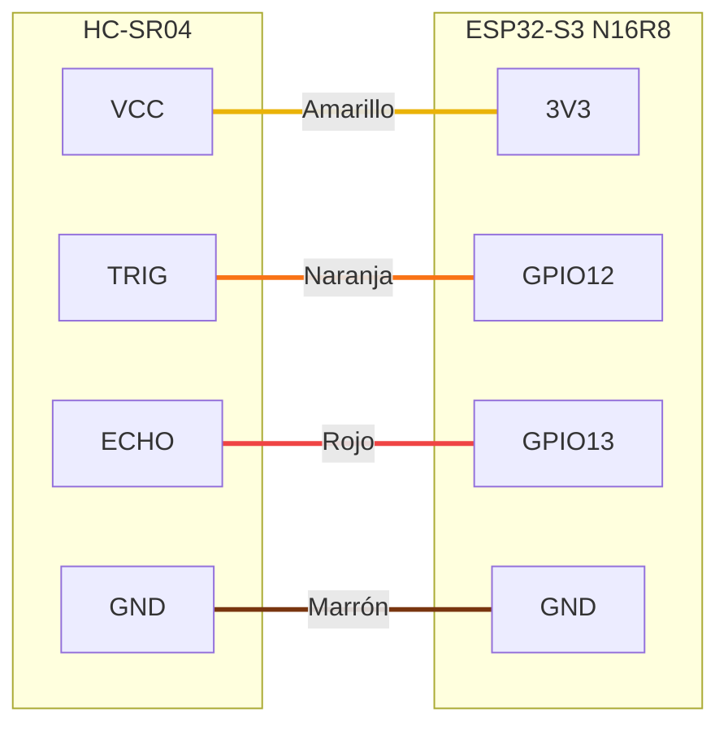

<div align="center">

# 📡 ESP32 Distance Monitoring System

**Sistema IoT de monitoreo de distancias basado en ESP32-S3 N16R8 y HC-SR04 con sincronización NTP, transmisión WiFi y almacenamiento en Firebase.**

### 🔴 [Ver el proyecto en vivo → jose-i-rm.github.io/esp32-distance-monitoring-system](https://jose-i-rm.github.io/esp32-distance-monitoring-system/)


[Demo en vivo](https://jose-i-rm.github.io/esp32-distance-monitoring-system/) · [Arquitectura](#-arquitectura) · [Arquitectura híbrida](#-arquitectura-híbrida) · [Cámara Tuya](#-integración-cámaras-ptz-tuya) · [Hardware](#-hardware-utilizado) · [Firmware](firmware/README.md) · [Firebase](docs/firebase.md) · [Roadmap](#-roadmap)

</div>

---

## 📖 Introducción

**ESP32 Distance Monitoring System** es una solución IoT de extremo a extremo. Un sensor ultrasónico **HC-SR04**, conectado a una **ESP32-S3 N16R8**, mide la distancia **cada 30 segundos**. La ESP32 marca cada lectura con la hora real (**NTP**) y la envía por **WiFi/HTTPS** a **Firebase Realtime Database**. Un **dashboard web** público muestra los datos y permite **descargarlos en Excel**.

**Novedad v4.1:** el origen de datos migró de la ESP32-CAM AI Thinker a la **ESP32-S3 N16R8**, reutilizando sin cambios el endpoint, la autenticación y el JSON de Firebase. Ver [docs/migracion-esp32-s3.md](docs/migracion-esp32-s3.md).

**v3:** cuando la distancia cambia **10 cm o más** entre dos lecturas consecutivas, la ESP32 registra una **alerta** y el dashboard la recibe **en tiempo real** con **sonido y mensaje**.

```
2026-11-12 09:41:55 | Distancia: 166.13 cm
  -> Guardado en Firebase
2026-11-12 09:42:25 | Distancia: 166.63 cm
  -> Guardado en Firebase
```

**¿Por qué Firebase?** El plan gratuito **Spark** no expira, no se suspende por inactividad y no requiere tarjeta. Ofrece 1 GB de almacenamiento y 10 GB de descarga al mes, suficiente para años de lecturas (≈ 2 880 lecturas/día ≈ 9 MB/mes).

## 🌐 Dashboard en vivo

👉 **https://jose-i-rm.github.io/esp32-distance-monitoring-system/**

| Funcionalidad | Detalle |
|---------------|---------|
| Distancia actual | Última lectura con barra proporcional (0–400 cm). |
| Estado del dispositivo | 🟢 En línea · 🟡 Retrasado · 🔴 Fuera de línea (según la antigüedad de la última lectura). |
| Estado de conexión | Conexión y latencia con Firebase. |
| Estadísticas | Mínimo, máximo, promedio y total de registros. |
| Gráfico temporal | Últimas 20 / 50 / 120 / 500 lecturas (Chart.js). |
| Historial | Tabla con hora de lectura y hora de recepción en Firebase. |
| **Descarga en Excel** | Archivo `.xlsx` con hojas **Lecturas** y **Resumen**. Puede filtrarse por rango de fechas o incluir el histórico completo. |
| **Alertas en tiempo real** | Banner con mensaje y **sonido** (botón *Activar sonido*, requisito del navegador) cuando la distancia cambia ≥ 10 cm. |
| **Historial de alertas** | Tabla con hora, distancia anterior, actual, cambio y tipo (acercamiento/alejamiento); las lecturas con alerta se marcan en rojo en el gráfico. |

Actualización inmediata por **streaming** de Firebase (Server-Sent Events) y refresco de respaldo cada 15 s.

## 🎯 Objetivos

**General:** implementar un sistema IoT funcional para la adquisición, almacenamiento y visualización de mediciones de distancia en tiempo casi real.

**Específicos:**

1. Adquirir mediciones del HC-SR04 con la ESP32-S3 y marcarlas con hora real sincronizada por NTP.
2. Transmitir las mediciones cada 30 s por HTTPS a Firebase con autenticación del dispositivo.
3. Persistir el histórico de forma permanente en Firebase Realtime Database.
4. Visualizar distancia actual, histórico, gráfico temporal y estado del dispositivo en un dashboard responsive.
5. Permitir la descarga de las lecturas en formato Excel.
6. Desplegar la solución en servicios gratuitos permanentes (Firebase Spark + GitHub Pages).

## 🏗 Arquitectura



| Capa | Tecnología | Hosting |
|------|-----------|---------|
| Borde | ESP32-S3 N16R8 + HC-SR04 (Arduino, `WiFiClientSecure` + `HTTPClient`) | Red WiFi doméstica |
| Autenticación | Firebase Authentication (correo/contraseña del dispositivo) | Firebase (Spark, gratis) |
| Datos | Firebase Realtime Database + reglas de seguridad | Firebase (Spark, gratis) |
| Frontend | HTML5, CSS3, Vanilla JavaScript, Chart.js, SheetJS | GitHub Pages |
| Documentación | Markdown + Mermaid.js | GitHub |

**Seguridad:** la lectura de los datos es pública (dashboard). Solo la cuenta de la ESP32 puede escribir. Las reglas validan el formato, el rango (0–1000 cm) y la hora del servidor, e impiden sobrescribir o borrar lecturas. Ver [firebase/database.rules.json](firebase/database.rules.json) y [docs/firebase.md](docs/firebase.md).

📐 Más diagramas: [arquitectura general](diagrams/01-arquitectura-general.md) · [hardware](diagrams/03-conexion-hardware.md) · [pipeline IA](diagrams/05-pipeline-ia.md) · [arquitectura híbrida](diagrams/07-arquitectura-hibrida.md)

## 🛰 Arquitectura Híbrida

El proyecto evoluciona hacia una **plataforma de vigilancia inteligente** que combina el radar terrestre
ESP32 con una **cámara PTZ IP de Tuya Cloud**, unificados en el backend **FastAPI + PostgreSQL**.



| Fuente | Qué aporta | Canal hacia FastAPI |
|--------|-----------|---------------------|
| Radar ESP32 + HC-SR04 + SG90 | Distancia (y ángulo, con el servo) cada 30 s con hora NTP | Hoy: Firebase (`PATCH` multiruta, ver [migración](docs/migracion-esp32-s3.md)). Previsto: `POST /api/v1/measurements` (`X-API-Key` del dispositivo) |
| Cámara PTZ Tuya | Estado, **detección humanoide**, **sonido anormal**, alarmas; control PTZ | Tuya OpenAPI firmada (`TuyaClient`) → `/api/camera/*` |
| FastAPI | Normaliza, deduplica y guarda en PostgreSQL (`measurements`, `camera_events`) | — |
| Dashboard | Radar (Firebase) + panel **Cámara PTZ Tuya** | HTTPS + `X-API-Key` de administración |

Detalle de flujos y secuencias: [diagrams/07-arquitectura-hibrida.md](diagrams/07-arquitectura-hibrida.md).

## 📹 Integración Cámaras PTZ Tuya

Módulo [`backend/app/integrations/tuya`](backend/app/integrations/tuya): cliente reutilizable
`TuyaClient` (firma HMAC-SHA256, token con renovación automática, errores tipados) y `CameraService`
(eventos, PTZ, vídeo y snapshot).

| Método | Endpoint | Función |
|--------|----------|---------|
| `GET` | `/api/camera/status` | Estado en vivo de la cámara (online, parámetros `motion_*`, `basic_*`, `ptz_*`) |
| `GET` | `/api/camera/events` | Eventos guardados en PostgreSQL (filtros por tipo y fechas) |
| `POST` | `/api/camera/events/sync` | Sincroniza eventos desde Tuya Cloud (idempotente) |
| `GET` | `/api/camera/latest` | Último evento |
| `POST` | `/api/camera/ptz` | Mover (8 direcciones), detener o ir a un *preset* |
| `GET` | `/api/camera/snapshot` | Imagen JPEG (stream o imagen de alarma, según disponibilidad) |
| `GET` | `/api/camera/stream` | URL temporal HLS/RTSP |

**Resultado de las pruebas con la cuenta real (Trial):**

| Capacidad | Estado |
|-----------|--------|
| Estado, parámetros y eventos (humanoid detection, abnormal sound, online) | ✅ Funciona |
| PTZ (`ptz_control`, `ptz_stop`, `ipc_preset_action`) | ✅ Funciona |
| Vídeo en vivo (HLS/RTSP/WebRTC) | ⏳ Requiere autorizar *IoT Video Live Stream* en el proyecto |
| Snapshot / imágenes de alarma | ⏳ Requiere Live Stream o la API de imágenes de alarma |
| Grabaciones en la nube | ❌ Requiere plan de pago en la cámara |

Configuración rápida (las credenciales van **solo** en `backend/.env`, ignorado por git):

```bash
cd backend
cp .env.example .env          # completar TUYA_* y ADMIN_API_KEY
alembic upgrade head
python scripts/tuya_probe.py  # diagnóstico de APIs disponibles
uvicorn app.main:app --reload
```

📄 Guía: [docs/tuya-camara.md](docs/tuya-camara.md) · Informe de APIs y límites de la cuenta gratuita: [docs/informe-apis-tuya.md](docs/informe-apis-tuya.md) · Seguridad: [docs/seguridad.md](docs/seguridad.md)

## 📡 Radar Terrestre ESP32 + Servo SG90

El HC-SR04 montado sobre un **servo SG90** convierte el medidor de distancia en un **radar de barrido**:

| Elemento | Conexión / valor |
|----------|------------------|
| HC-SR04 | TRIG → GPIO12 · ECHO → GPIO13 (VCC 3V3, sin divisor) |
| Servo SG90 | Señal → **GPIO15** (PWM LEDC 50 Hz, librería `ESP32Servo`) · alimentación **5 V externa** con GND común (picos ~250 mA) |
| Barrido | 0° → 180° en pasos de 15° (13 posiciones), ~300 ms de asentamiento por paso |
| Medición | Mediana de 3 lecturas por ángulo; hora NTP |



Contrato previsto (compatible con el actual): `{"timestamp": "...", "distance_cm": 123.4, "angle_deg": 90}`.
El dashboard podrá dibujar un **gráfico polar** (Chart.js `polarArea`/`scatter`) y el backend orientar
la cámara PTZ hacia el sector donde el radar detecte cambios. Estado: **pendiente de integración en firmware**.

## 🤖 Roadmap IA

| Etapa | Alcance | Prerrequisito |
|-------|---------|---------------|
| IA-0 | Eventos de la cámara (detección humanoide de Tuya) en PostgreSQL | ✅ Hecho |
| IA-1 | Snapshot fiable (Live Stream + ffmpeg) | Autorizar *IoT Video Live Stream* |
| IA-2 | Detección de rostros en eventos `humanoid_detection` | IA-1 |
| IA-3 | Reconocimiento facial contra lista blanca | IA-2 + consentimiento |
| IA-4 | Incidentes, notificaciones y seguimiento PTZ automático | IA-3 |
| IA-5 | Fusión radar + cámara (confirmación física, antispoofing) | Servo SG90 |

## 🧑‍💼 Reconocimiento Facial Futuro

> La primera versión **no** implementa biometría; queda diseñada y documentada.



Stack propuesto: YuNet (detección) + ArcFace (embeddings 512-D) + **pgvector** en PostgreSQL, worker
asíncrono, solo embeddings (sin fotos) y consentimiento explícito. Diseño completo, modelo de datos
y requisitos de privacidad: [docs/reconocimiento-facial.md](docs/reconocimiento-facial.md).

## 🗄 Modelo de datos (Firebase)

```json
{
  "measurements": {
    "1793553552": {
      "epoch": 1793553552,
      "ts": "2026-11-01T11:08:55-05:00",
      "distance_cm": 214.05,
      "received_at": 1793553553502,
      "device": "esp32-s3-01"
    }
  },
  "alerts": {
    "1793553582": {
      "epoch": 1793553582,
      "ts": "2026-11-01T11:09:25-05:00",
      "previous_cm": 214.05,
      "distance_cm": 4.92,
      "delta_cm": -209.13,
      "type": "acercamiento",
      "threshold_cm": 10.0,
      "received_at": 1793553583410,
      "device": "esp32-s3-01"
    }
  },
  "stats": {
    "count": 2,
    "latest": { "...": "copia de la última lectura" },
    "alert_count": 1,
    "last_alert": { "...": "copia de la última alerta" }
  }
}
```

| Campo | Descripción |
|-------|-------------|
| clave / `epoch` | Segundos UTC de la lectura (NTP). Ordena las lecturas cronológicamente. |
| `ts` | Fecha y hora local del dispositivo (ISO 8601, UTC-5). |
| `distance_cm` | Distancia medida, 2 decimales. |
| `received_at` | Hora del servidor de Firebase al recibir la lectura (ms). |
| `device` | Etiqueta del dispositivo: `esp32-s3-01` desde la migración (las lecturas históricas conservan `esp32-cam-01`). |
| `previous_cm` / `delta_cm` | (Alertas) Lectura anterior y cambio `actual − anterior`; negativo = acercamiento. |
| `type` / `threshold_cm` | (Alertas) `acercamiento` o `alejamiento` y umbral aplicado (10 cm). |

## 🔧 Hardware utilizado

| Componente | Función |
|-----------|---------|
| **ESP32-S3 N16R8** | Microcontrolador dual core 240 MHz con WiFi, 16 MB flash y 8 MB PSRAM octal (sustituye a la ESP32-CAM AI Thinker). |
| **Placa de expansión ESP32-S3** | Hileras GND / VCC / señal por cada GPIO. |
| **HC-SR04** | Sensor ultrasónico de distancia (2–400 cm), alimentado a 3V3. |
| **Cable USB-C de datos** | Programación y alimentación (conector COM, chip CH343). |
| **Red WiFi 2.4 GHz** | Conectividad a Internet. |

Detalle técnico: [docs/hardware.md](docs/hardware.md).

## 🔌 Esquema de conexiones

| HC-SR04 | ESP32-S3 N16R8 | Cable |
|---------|----------------|-------|
| VCC | 3V3 | 🟡 Amarillo |
| GND | GND | 🟤 Marrón |
| TRIG | GPIO12 | 🟠 Naranja |
| ECHO | GPIO13 | 🔴 Rojo |



> ✅ Alimentado a **3V3**, ECHO entrega ≤ 3.3 V: conexión directa al GPIO13 sin divisor (los GPIO del S3 no toleran 5 V). Si su módulo no responde a 3V3 (variante solo 5 V), aliméntelo a 5V y use un divisor 1 kΩ / 2 kΩ en ECHO — ver [consideraciones eléctricas](docs/hardware.md#4-consideraciones-eléctricas).

## 📁 Estructura del repositorio

```
/
├── README.md                 # Este documento
├── firebase.json             # Configuración de Firebase CLI (reglas de la BD)
├── .firebaserc               # Proyecto Firebase por defecto
├── firebase/                 # Reglas de seguridad de Realtime Database
├── firmware/                 # Sketch Arduino de la ESP32-S3 N16R8 (Firebase)
├── frontend/                 # Dashboard HTML5 + JS + Chart.js + SheetJS (GitHub Pages)
├── processing/               # Pipeline ETL en Python: preprocesamiento, filtrado y transformación
├── .github/workflows/        # Despliegue en GitHub Pages y CI del backend alternativo
├── docs/                     # Documentación técnica
├── diagrams/                 # Diagramas Mermaid
├── backend/ · api/ · deployment/ · render.yaml
│                             # Backend FastAPI + PostgreSQL: mediciones + integración cámara PTZ Tuya
└── LICENSE
```

## ⚙ Puesta en marcha

### 1. Firmware (ESP32-S3 N16R8)

1. Abra [`firmware/esp32_distance_firebase/esp32_distance_firebase.ino`](firmware/esp32_distance_firebase/esp32_distance_firebase.ino) en Arduino IDE.
2. Copie `secrets.example.h` como `secrets.h` en la misma carpeta y complete el WiFi, la API key web de Firebase y la clave del dispositivo.
3. Placa **ESP32S3 Dev Module** (core ESP32 de Espressif 3.x), *Flash Size* 16MB, *PSRAM* OPI → **Subir**.
4. Monitor serie a 115200 baudios: cada 30 s debe verse `-> Guardado en Firebase`.

Detalle: [firmware/README.md](firmware/README.md) · Endpoint real, JSON y pruebas: [docs/migracion-esp32-s3.md](docs/migracion-esp32-s3.md).

### 2. Firebase

El proyecto `esp32-distance-jirm-450f1` ya está creado y configurado. Para redesplegar las reglas:

```bash
npm install -g firebase-tools
firebase login
firebase deploy --only database
```

Guía completa (crear desde cero, cuenta del dispositivo, límites): [docs/firebase.md](docs/firebase.md).

### 3. Dashboard

Se publica automáticamente en GitHub Pages con cada push a `main` que modifique `frontend/`. Para probarlo localmente:

```bash
cd frontend && python -m http.server 5500
# http://localhost:5500
```

### 4. Procesamiento de datos

```bash
pip install -r processing/requirements.txt
python processing/pipeline.py      # descarga de Firebase → processing/output/ (Excel, CSV, figuras)
```

Detalle de las operaciones: [processing/README.md](processing/README.md).

## 🗺 Roadmap

| Fase | Alcance | Estado |
|------|---------|--------|
| 1 | Firmware: WiFi + NTP + HC-SR04 cada 30 s | ✅ Completado |
| 2 | Envío autenticado a Firebase Realtime Database | ✅ Completado |
| 3 | Dashboard en GitHub Pages + descarga en Excel | ✅ Completado |
| 4 | Alertas por cambio de distancia (≥ 10 cm) con sonido y mensaje en tiempo real | ✅ Completado |
| 5 | Procesamiento de datos (preprocesamiento, filtrado y transformación) | ✅ Completado |
| 6 | Servo SG90: barrido angular tipo radar | 📋 Siguiente iteración |
| 7 | **Cámara PTZ Tuya:** estado, eventos en PostgreSQL, PTZ y panel en el dashboard | ✅ Completado |
| 8 | Vídeo en vivo y snapshot de la cámara Tuya | ⏳ Pendiente de autorizar *IoT Video Live Stream* |
| 9 | MQTT / Tuya Message Service (eventos por *push*) | 📋 Planificado |
| 10 | Reconocimiento facial con lista blanca e incidentes | 📐 Diseñado ([docs](docs/reconocimiento-facial.md)) |

## 🔮 Futuras mejoras

- Búfer local en la ESP32 para reenviar lecturas cuando se pierde el WiFi.
- Notificaciones externas de las alertas (Telegram/correo).
- **MQTT**, **servo SG90**, **cámara** e **IA con Hugging Face** — ver [docs/futuras-integraciones.md](docs/futuras-integraciones.md).

## 📚 Documentación

| Documento | Descripción |
|-----------|-------------|
| [docs/firebase.md](docs/firebase.md) | Proyecto Firebase, reglas, cuenta del dispositivo y límites del plan gratuito |
| [docs/migracion-esp32-s3.md](docs/migracion-esp32-s3.md) | Migración ESP32-CAM → ESP32-S3: endpoint real, JSON, autenticación, pruebas y compatibilidad HC-SR04 |
| [docs/tuya-camara.md](docs/tuya-camara.md) | Integración de la cámara PTZ Tuya: configuración, endpoints y esquema `camera_events` |
| [docs/informe-apis-tuya.md](docs/informe-apis-tuya.md) | APIs Tuya investigadas: PTZ, vídeo, snapshot y límites de la cuenta gratuita |
| [docs/reconocimiento-facial.md](docs/reconocimiento-facial.md) | Diseño del reconocimiento facial futuro |
| [docs/seguridad.md](docs/seguridad.md) | Gestión de secretos y controles de seguridad |
| [firmware/README.md](firmware/README.md) | Firmware, configuración y contrato de datos |
| [docs/frontend.md](docs/frontend.md) | Dashboard, alertas con sonido y exportación a Excel |
| [processing/README.md](processing/README.md) | Pipeline de preprocesamiento, filtrado y transformación |
| [docs/hardware.md](docs/hardware.md) | Componentes, conexiones y consideraciones eléctricas |
| [docs/credenciales-pendientes.md](docs/credenciales-pendientes.md) | Estado de cuentas y credenciales |
| [docs/solucion-de-problemas.md](docs/solucion-de-problemas.md) | Errores frecuentes |
| [docs/arquitectura.md](docs/arquitectura.md) · [docs/instalacion.md](docs/instalacion.md) · [docs/base-de-datos.md](docs/base-de-datos.md) | Backend alternativo FastAPI + PostgreSQL |

## 📄 Licencia

Distribuido bajo la licencia **MIT**. Consulte [LICENSE](LICENSE).
