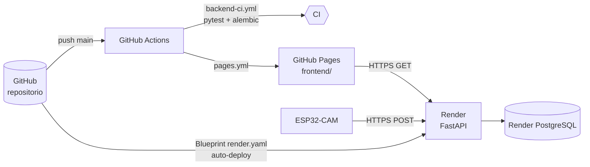

# Despliegue

> **Despliegue actual:** Firebase Realtime Database (datos) + GitHub Pages (dashboard). Ver [../docs/firebase.md](../docs/firebase.md).
> El contenido de esta carpeta corresponde al **backend alternativo FastAPI + PostgreSQL**, que se conserva como opción y no está en uso.



| Componente | Proveedor principal | Alternativas | Guía |
|-----------|---------------------|--------------|------|
| Backend FastAPI | **Render** (free) | Railway, Fly.io | [render/](./render/README.md) · [railway/](./railway/README.md) · [fly/](./fly/README.md) |
| PostgreSQL | **Render PostgreSQL** (free, 30 días) | Neon, Supabase, Railway | [render/](./render/README.md#base-de-datos-permanente) |
| Frontend | **GitHub Pages** | Netlify, Cloudflare Pages | [github-pages.md](./github-pages.md) |
| Local | Docker Compose | Python + PostgreSQL nativo | [docker/](./docker/README.md) |

## Orden recomendado

1. **Backend en Render** → obtener URL pública y `DEVICE_API_KEY`.
2. **Variable `API_BASE_URL`** en GitHub → desplegar el **frontend en GitHub Pages**.
3. **Firmware** → apuntar a `https://<servicio>.onrender.com/api/v1/measurements` con la API Key.
4. Verificar con `GET /health`, el simulador y el dashboard.

## Verificación posterior al despliegue

```bash
API=https://<servicio>.onrender.com
curl -s $API/health
curl -s -X POST $API/api/v1/measurements -H "Content-Type: application/json" \
  -H "X-API-Key: <DEVICE_API_KEY>" -d '{"timestamp":"2026-11-01T16:08:55Z","distance_cm":214.05}'
curl -s $API/api/v1/measurements/latest
```

Credenciales por completar: [../docs/credenciales-pendientes.md](../docs/credenciales-pendientes.md).

## Comparativa de planes gratuitos

| Proveedor | Cómputo | PostgreSQL | Limitaciones relevantes |
|-----------|---------|-----------|-------------------------|
| Render | 750 h/mes | 1 GB, expira a los 30 días | Suspensión tras 15 min sin tráfico (arranque en frío ~50 s). |
| Railway | Crédito mensual de prueba | Incluido en crédito | Requiere plan de pago tras agotar el crédito. |
| Fly.io | Máquinas pequeñas | Postgres gestionado de pago / autogestionado | Requiere tarjeta para la cuenta. |
| Neon | — | 0.5 GB permanente | Solo base de datos; combinable con Render. |

> Las condiciones de los planes gratuitos cambian con frecuencia; verifique la página oficial de cada proveedor.
