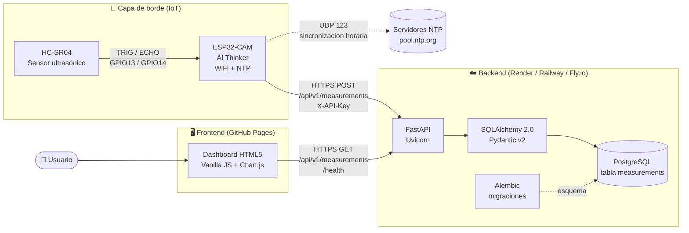

# 1. Arquitectura general

Vista de alto nivel de los componentes del sistema y sus responsabilidades.

## Componentes

| Capa | Componente | Responsabilidad |
|------|------------|-----------------|
| Borde | HC-SR04 | Medición de distancia por tiempo de vuelo ultrasónico (2–400 cm). |
| Borde | ESP32-CAM | Disparo del sensor, marca de tiempo NTP y envío HTTP cada 30 s. |
| Backend | FastAPI | Validación (Pydantic), autenticación por API Key y exposición REST. |
| Backend | PostgreSQL | Persistencia histórica de mediciones. |
| Frontend | Dashboard | Visualización en tiempo casi real, historial y estado del dispositivo. |
