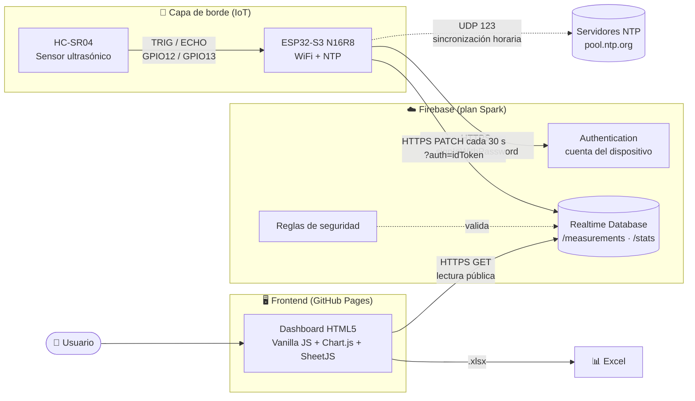

# 1. Arquitectura general

Vista de alto nivel de los componentes del sistema y sus responsabilidades.

## Componentes

| Capa | Componente | Responsabilidad |
|------|------------|-----------------|
| Borde | HC-SR04 | Medición de distancia por tiempo de vuelo ultrasónico (2–400 cm). |
| Borde | ESP32-S3 N16R8 | Disparo del sensor, marca de tiempo NTP y envío HTTPS cada 30 s. |
| Nube | Firebase Authentication | Emite el token del dispositivo (1 h). |
| Nube | Firebase Realtime Database | Persistencia permanente; reglas que solo permiten escribir al dispositivo. |
| Frontend | Dashboard | Visualización en tiempo casi real, historial, estado y descarga en Excel. |
