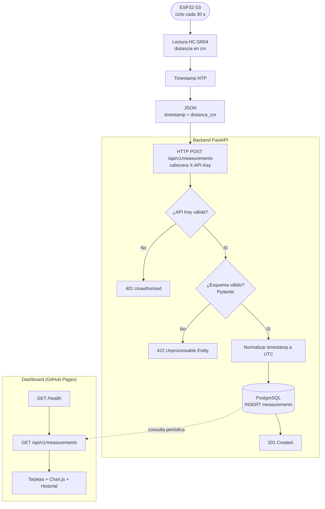

# 2. Flujo de datos

Recorrido de una medición desde el sensor hasta el dashboard.



## Formato del mensaje

```json
{
  "timestamp": "2026-11-01T16:08:55Z",
  "distance_cm": 214.05
}
```

> La lectura `2026-11-01 11:08:55 | Distancia: 214.05 cm` (hora local Colombia, UTC-5) equivale a `2026-11-01T16:08:55Z` en UTC. El backend acepta ambos formatos (`...Z` o `...-05:00`) y almacena siempre en UTC; el dashboard la muestra en la hora local del navegador.
