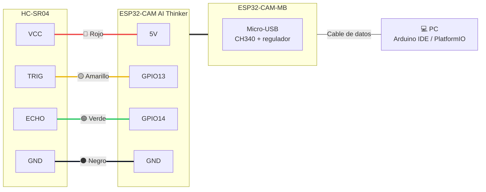

# 3. Conexión de hardware

## Diagrama de cableado

## Tabla de conexiones

| HC-SR04 | ESP32-CAM | Color del cable | Función |
|---------|-----------|-----------------|---------|
| VCC | 5V | 🔴 Rojo | Alimentación del sensor |
| GND | GND | ⚫ Negro | Referencia común |
| TRIG | GPIO13 | 🟡 Amarillo | Pulso de disparo (salida ESP32) |
| ECHO | GPIO14 | 🟢 Verde | Pulso de eco (entrada ESP32) |

## Diagrama de señales

> ⚠️ **Nivel lógico de ECHO:** el HC-SR04 alimentado a 5 V entrega 5 V en ECHO, mientras que los GPIO del ESP32 trabajan a 3.3 V. Ver la recomendación del divisor resistivo en [docs/hardware.md](../docs/hardware.md#4-consideraciones-eléctricas).
