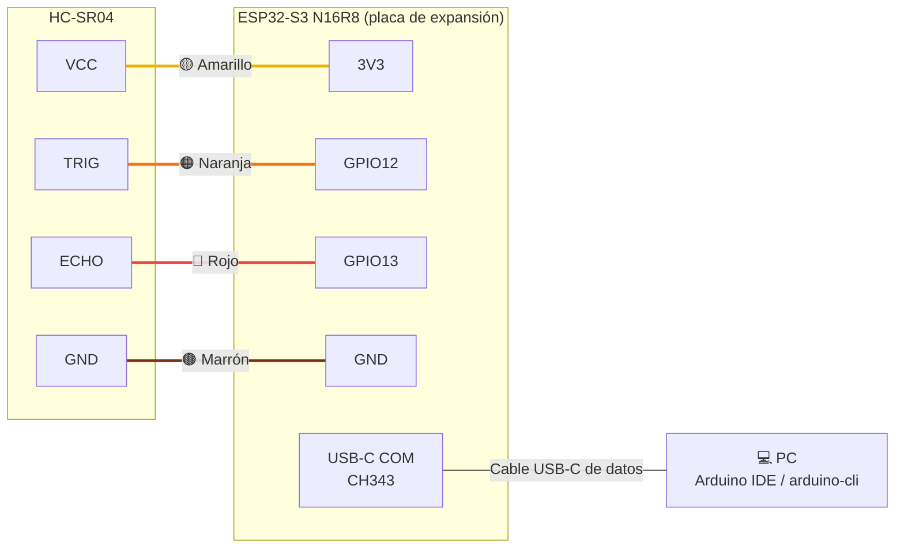
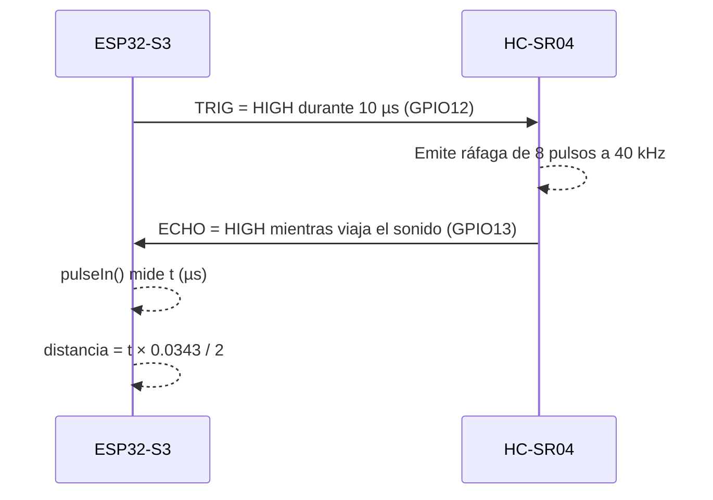

# 3. Conexión de hardware

## Diagrama de cableado

## Tabla de conexiones

| HC-SR04 | ESP32-S3 N16R8 | Color del cable | Función |
|---------|----------------|-----------------|---------|
| VCC | 3V3 | 🟡 Amarillo | Alimentación del sensor |
| GND | GND | 🟤 Marrón | Referencia común |
| TRIG | GPIO12 | 🟠 Naranja | Pulso de disparo (salida ESP32) |
| ECHO | GPIO13 | 🔴 Rojo | Pulso de eco (entrada ESP32) |

## Diagrama de señales

> ✅ **Nivel lógico de ECHO:** con el HC-SR04 alimentado a 3V3, ECHO entrega ≤ 3.3 V y se conecta directamente. Si se alimenta a 5 V, use el divisor resistivo de [docs/hardware.md](../docs/hardware.md#4-consideraciones-eléctricas).
