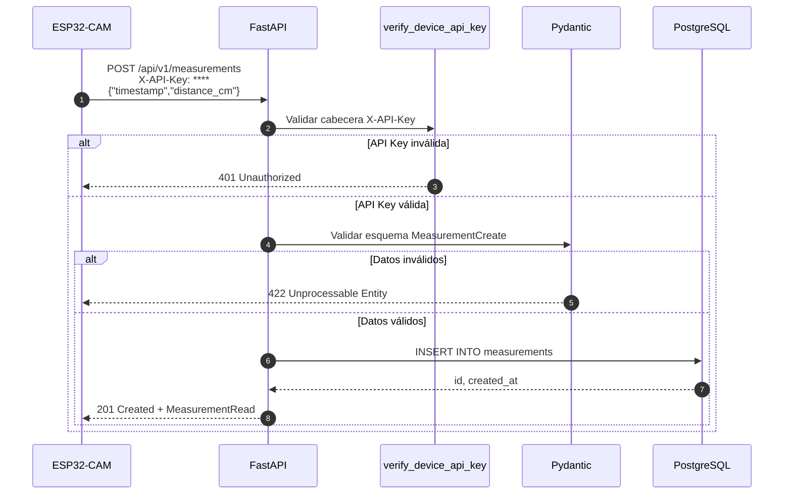
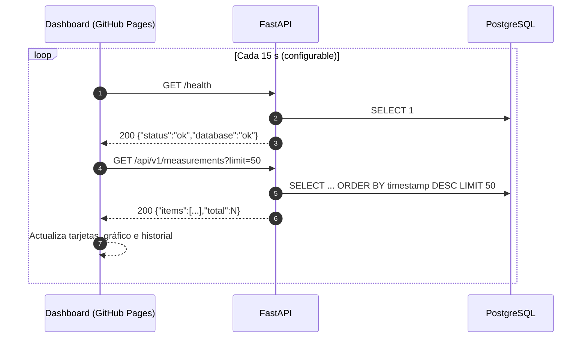

# 4. Flujo HTTP

## Registro de una medición (dispositivo → API)

## Consulta desde el dashboard (navegador → API)

## Códigos de respuesta

| Código | Significado | Endpoint |
|--------|-------------|----------|
| 200 | Consulta exitosa | `GET` |
| 201 | Medición creada | `POST /api/v1/measurements` |
| 401 | API Key ausente o inválida | `POST /api/v1/measurements` |
| 404 | No existen mediciones | `GET /api/v1/measurements/latest` |
| 422 | Error de validación | Todos |
| 503 | Base de datos no disponible | `GET /health` |
