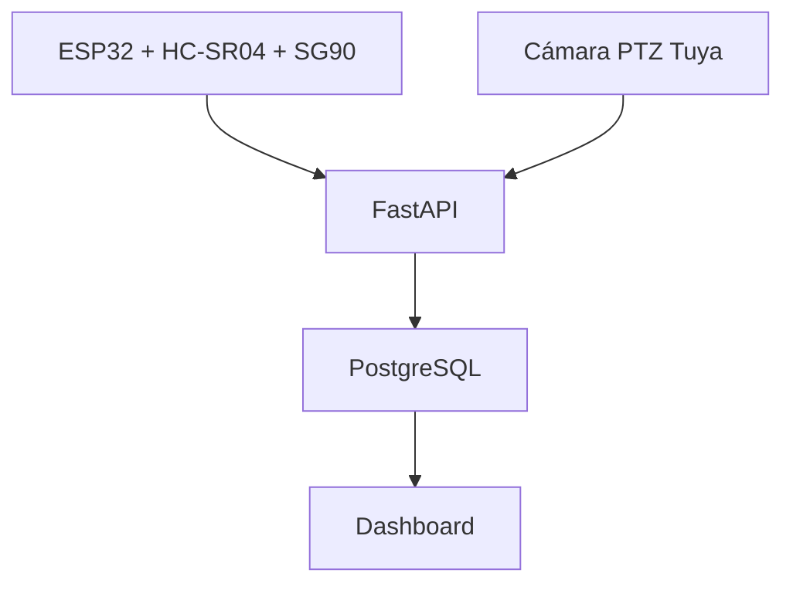
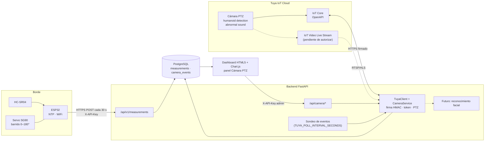
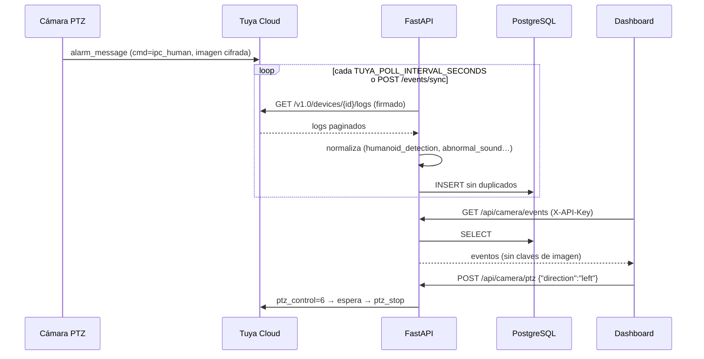

# 7. Arquitectura híbrida: radar ESP32 + cámara PTZ Tuya

## Vista general

## Detalle de flujos

## Secuencia: detección humanoide → evento guardado

## Correlación radar ↔ cámara (siguiente iteración)

Cuando el radar detecte un cambio ≥ 10 cm en el ángulo θ del servo, el backend podrá:

1. Buscar eventos `humanoid_detection` en una ventana de ±30 s.
2. Si no hay, orientar la cámara (`ptz_control`/`ipc_preset_action` según θ) y solicitar snapshot.
3. Registrar un **incidente** con la medición y el evento asociados (ver [reconocimiento facial](../docs/reconocimiento-facial.md)).
