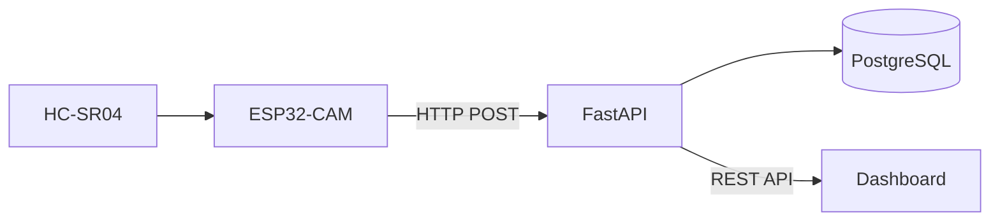
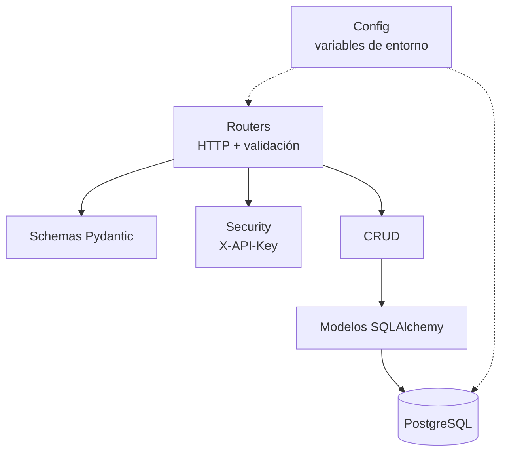

# Arquitectura de software

## 1. Visión general

El sistema sigue una arquitectura **cliente–servidor de tres capas** orientada a IoT:

1. **Capa de borde:** ESP32-CAM + HC-SR04. Adquiere, filtra y marca temporalmente las mediciones.
2. **Capa de servicios:** API REST en FastAPI con persistencia en PostgreSQL.
3. **Capa de presentación:** dashboard estático (HTML5 + Vanilla JS + Chart.js) servido desde GitHub Pages.



Diagramas detallados en [../diagrams/](../diagrams/README.md).

## 2. Estructura del backend

```
backend/
├── app/
│   ├── main.py            # Instancia FastAPI, CORS, routers
│   ├── config.py          # Settings (pydantic-settings) desde variables de entorno
│   ├── database.py        # Engine, SessionLocal, Base declarativa
│   ├── models.py          # Modelo ORM Measurement
│   ├── schemas.py         # Esquemas Pydantic de entrada/salida
│   ├── crud.py            # Acceso a datos
│   ├── security.py        # Validación de X-API-Key
│   ├── routers/
│   │   ├── health.py      # GET /health
│   │   └── measurements.py# /api/v1/measurements
│   └── integrations/      # Puntos de extensión (MQTT, Hugging Face)
├── alembic/               # Migraciones de esquema
├── tests/                 # Pruebas con pytest + SQLite en memoria
├── Dockerfile
├── Procfile
└── requirements.txt
```

### Capas internas



## 3. Decisiones de diseño

| Decisión | Justificación |
|----------|---------------|
| **FastAPI** | Alto rendimiento, validación automática con Pydantic, documentación OpenAPI integrada (`/docs`) y ecosistema Python natural para IA. |
| **PostgreSQL** | Robusto, gratuito en Render/Railway/Neon, soporte nativo de `TIMESTAMPTZ` y extensible (TimescaleDB) para series temporales. |
| **SQLAlchemy 2.0 + Alembic** | ORM tipado y migraciones versionadas reproducibles en todos los entornos. |
| **HTTP en lugar de MQTT (fase 1)** | Menos infraestructura (sin broker); compatible con hosting gratuito. MQTT queda planificado. |
| **Timestamps en UTC** | El firmware envía UTC (`Z`); el backend normaliza a UTC; el navegador convierte a hora local. Evita errores con zonas horarias. |
| **Frontend sin framework** | Peso mínimo, sin build step, desplegable directamente en GitHub Pages. |
| **API Key por cabecera** | Mecanismo simple y adecuado para un dispositivo embebido con recursos limitados. |
| **Firmware desacoplado** | El backend solo exige el contrato JSON documentado en [../firmware/README.md](../firmware/README.md); el firmware puede evolucionar de forma independiente. |

## 4. Seguridad

- **Autenticación del dispositivo:** cabecera `X-API-Key` comparada en tiempo constante (`secrets.compare_digest`). Si `DEVICE_API_KEY` está vacía, el endpoint queda abierto (solo para desarrollo).
- **Lectura pública:** los `GET` son públicos para que el dashboard funcione sin credenciales en el navegador. Si los datos se vuelven sensibles, se recomienda añadir autenticación de lectura (ver roadmap).
- **CORS restringido:** `CORS_ORIGINS` debe contener solo el dominio de GitHub Pages en producción.
- **TLS:** Render, Railway y Fly.io sirven HTTPS. En el firmware se debe usar `WiFiClientSecure` (idealmente con el certificado raíz del dominio).
- **Secretos:** `.env` y los archivos de credenciales del firmware (`config.h`, `secrets.h`) están en `.gitignore`. Nunca deben subirse al repositorio.
- **Validación de entrada:** `distance_cm` ∈ [0, 1000] y `timestamp` ISO 8601 obligatorio.

## 5. Escalabilidad

| Escenario | Estrategia |
|-----------|-----------|
| Múltiples dispositivos | Agregar tabla `devices` y columna `device_id` (ver [06-modelo-datos.md](../diagrams/06-modelo-datos.md)). |
| Alto volumen de lecturas | Índice por `timestamp` (ya existe), particionamiento o TimescaleDB, agregaciones por ventana. |
| Tiempo real | WebSockets / Server-Sent Events en FastAPI o MQTT sobre WebSockets. |
| Procesamiento IA | Tareas en segundo plano (BackgroundTasks → Celery/RQ) para no bloquear la ingesta. |
