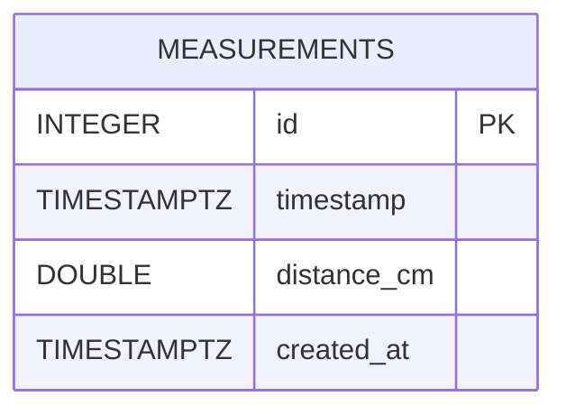

# Base de datos

## Motor

**PostgreSQL 14+**. El acceso se realiza con SQLAlchemy 2.0 y el driver `psycopg` (v3). La URL de conexión se toma de `DATABASE_URL`; los prefijos `postgres://` y `postgresql://` entregados por los proveedores se normalizan automáticamente a `postgresql+psycopg://`.

## Tabla `measurements`

| Columna | Tipo | Nulo | Por defecto | Descripción |
|---------|------|------|-------------|-------------|
| `id` | `INTEGER` (serial) | No | autoincremental | Clave primaria. |
| `timestamp` | `TIMESTAMP WITH TIME ZONE` | No | — | Momento de la lectura generado por la ESP32 (NTP), almacenado en UTC. |
| `distance_cm` | `DOUBLE PRECISION` | No | — | Distancia medida en centímetros (2 decimales). |
| `created_at` | `TIMESTAMP WITH TIME ZONE` | No | `now()` | Momento en que el backend recibió la lectura. |

Índices: `measurements_pkey (id)`, `ix_measurements_timestamp (timestamp)`.



### DDL equivalente

```sql
CREATE TABLE measurements (
    id          SERIAL PRIMARY KEY,
    timestamp   TIMESTAMPTZ      NOT NULL,
    distance_cm DOUBLE PRECISION NOT NULL,
    created_at  TIMESTAMPTZ      NOT NULL DEFAULT now()
);
CREATE INDEX ix_measurements_timestamp ON measurements (timestamp);
```

> La diferencia `created_at - timestamp` permite medir la latencia extremo a extremo (dispositivo → servidor).

## Migraciones con Alembic

```bash
cd backend
alembic upgrade head                          # Aplicar migraciones
alembic current                               # Ver versión actual
alembic downgrade -1                          # Revertir la última
alembic revision --autogenerate -m "mensaje"  # Crear migración a partir de cambios en models.py
```

| Revisión | Descripción |
|----------|-------------|
| `0001_create_measurements` | Crea la tabla `measurements` y su índice por `timestamp`. |

## Consultas útiles

```sql
-- Últimas 10 lecturas en hora de Colombia
SELECT id, timestamp AT TIME ZONE 'America/Bogota' AS hora_local, distance_cm
FROM measurements ORDER BY timestamp DESC LIMIT 10;

-- Promedio, mínimo y máximo por hora
SELECT date_trunc('hour', timestamp) AS hora,
       round(avg(distance_cm)::numeric, 2) AS promedio,
       min(distance_cm) AS minimo, max(distance_cm) AS maximo, count(*) AS lecturas
FROM measurements GROUP BY 1 ORDER BY 1 DESC;

-- Latencia promedio de recepción (segundos)
SELECT avg(extract(epoch FROM created_at - timestamp)) FROM measurements;

-- Detección de huecos (> 90 s sin lecturas)
SELECT timestamp, timestamp - lag(timestamp) OVER (ORDER BY timestamp) AS hueco
FROM measurements
ORDER BY timestamp DESC
LIMIT 100;
```

## Volumen estimado

Con una lectura cada 30 s: **2 880 filas/día ≈ 1 millón/año**, ~60–80 MB incluyendo índices. Está holgadamente dentro del plan gratuito de Render (1 GB).

## Respaldo

```bash
pg_dump "$DATABASE_URL" --format=custom --file=backup_$(date +%F).dump
pg_restore --dbname "$DATABASE_URL" --clean backup_YYYY-MM-DD.dump
```

> ⚠️ Las bases PostgreSQL gratuitas de Render **expiran a los 30 días**. Programe respaldos o use Neon/Supabase (ver [../deployment/README.md](../deployment/README.md)).
