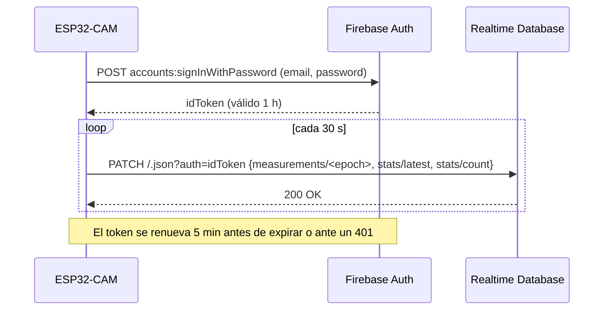

# Firebase

El sistema usa **Firebase Realtime Database** como backend: almacena las lecturas y las expone por HTTPS al dashboard. El plan gratuito **Spark** no expira, no se suspende por inactividad y no requiere tarjeta.

| Recurso | Valor |
|---------|-------|
| Proyecto | `esp32-distance-jirm-450f1` |
| Consola | https://console.firebase.google.com/project/esp32-distance-jirm-450f1 |
| Base de datos | `https://esp32-distance-jirm-450f1-default-rtdb.firebaseio.com` (us-central1) |
| Autenticación | Correo/contraseña; registro público **deshabilitado** |
| Cuenta del dispositivo | `esp32-cam-01@esp32-distance.iot` (UID `jz0Com63Fkam7s5IuOkolcWOdAL2`) |
| Reglas | [`firebase/database.rules.json`](../firebase/database.rules.json) |

> La **API key web** y la URL de la base de datos no son secretas (identifican el proyecto). La **contraseña del dispositivo** sí lo es: solo vive en `secrets.h` de la placa, que está excluido de Git.

## Flujo del dispositivo



La escritura es **multiruta y atómica**: la lectura, `stats/latest` y el contador `stats/count` (incremento en servidor) se guardan juntos o no se guarda nada.

## Reglas de seguridad

| Ruta | Lectura | Escritura |
|------|---------|-----------|
| `/measurements` | Pública | Solo el UID del dispositivo; **no** permite sobrescribir ni borrar (`!data.exists()`). |
| `/stats` | Pública | Solo el UID del dispositivo. |
| Resto | Denegada | Denegada |

Validaciones: clave de 10 dígitos (epoch), `distance_cm` numérico entre 0 y 1000, `ts` texto ≤ 40 caracteres, `received_at` igual a la hora del servidor y sin campos adicionales.

Desplegar cambios en las reglas:

```bash
npm install -g firebase-tools     # En PowerShell use firebase.cmd si la política de scripts bloquea firebase.ps1
firebase login                    # Si falla en Windows: firebase login --no-localhost
firebase deploy --only database
```

## Consultas útiles (REST)

```bash
DB=https://esp32-distance-jirm-450f1-default-rtdb.firebaseio.com
curl "$DB/stats.json"                                                  # Total y última lectura
curl "$DB/measurements.json?orderBy=\"\$key\"&limitToLast=10"          # Últimas 10
curl "$DB/measurements.json?orderBy=\"\$key\"&startAt=\"1793502000\"&endAt=\"1793588399\""  # Rango por epoch
```

## Crear el proyecto desde cero (referencia)

1. https://console.firebase.google.com → **Crear proyecto** (sin Google Analytics).
2. **Compilación → Realtime Database → Crear base de datos** (us-central1, modo bloqueado).
3. **Compilación → Authentication → Comenzar → Correo electrónico/contraseña → Habilitar**.
4. **Authentication → Usuarios → Agregar usuario**: correo del dispositivo y una contraseña aleatoria.
5. Reemplazar el UID en [`firebase/database.rules.json`](../firebase/database.rules.json) y ejecutar `firebase deploy --only database`.
6. **Configuración del proyecto → General → Agregar app web** para obtener la *API key web*.
7. Actualizar `FIREBASE_DB_URL` en [`frontend/js/config.js`](../frontend/js/config.js) y los valores de `secrets.h` del firmware.

## Límites del plan Spark

| Recurso | Límite gratuito | Uso estimado |
|---------|-----------------|--------------|
| Almacenamiento | 1 GB | ≈ 9 MB/mes (2 880 lecturas/día) |
| Descarga | 10 GB/mes | Dashboard: ~5 KB por refresco |
| Conexiones simultáneas | 100 | Sobra para uso académico |

> Las condiciones de los planes gratuitos pueden cambiar; verifique https://firebase.google.com/pricing.

## Rotar la contraseña del dispositivo

1. Consola → **Authentication → Usuarios** → menú del usuario → **Restablecer contraseña** (o eliminar y recrear; si cambia el UID, actualice las reglas).
2. Actualice `DEVICE_PASSWORD` en `secrets.h` y vuelva a cargar el firmware.
