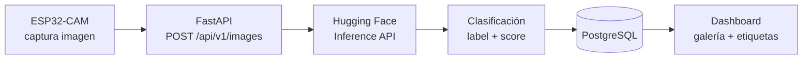

# Futuras integraciones

Este documento describe cómo extender el sistema manteniendo la arquitectura actual. Los puntos de extensión del backend se encuentran en [`backend/app/integrations/`](../backend/app/integrations/).

## 1. MQTT

**Objetivo:** reducir el consumo energético y la latencia, y habilitar comunicación bidireccional (comandos al dispositivo).

| Elemento | Propuesta |
|----------|-----------|
| Broker | Mosquitto (autoalojado), HiveMQ Cloud o EMQX Cloud (planes gratuitos). |
| Cliente backend | `aiomqtt` ejecutado en el `lifespan` de FastAPI. |
| Tópicos | `esp32/{device_id}/distance`, `esp32/{device_id}/status` (LWT), `esp32/{device_id}/servo/set`. |
| QoS | 1 para mediciones, 0 para telemetría de estado. |
| Seguridad | TLS (8883) + usuario/contraseña por dispositivo. |

El consumidor reutilizará `crud.create_measurement`, por lo que el modelo de datos no cambia. HTTP se mantiene como canal alternativo.

## 2. Servo SG90

**Objetivo:** orientar el sensor o la cámara para barrer un área.

- Pin sugerido: GPIO15 (PWM con LEDC a 50 Hz, pulso 0.5–2.4 ms).
- Alimentación externa de 5 V con GND común (picos de ~250 mA).
- Endpoint previsto: `POST /api/v1/devices/{id}/servo` `{"angle": 90}` → publicado por MQTT.
- Nueva columna opcional `angle_deg` en `measurements` para mapas polares de distancia.

## 3. Cámara ESP32-CAM

**Objetivo:** capturar una imagen cuando la distancia cruce un umbral (p. ej. < 50 cm).

- Endpoint previsto: `POST /api/v1/images` (`multipart/form-data`, JPEG VGA ~30–60 KB).
- Almacenamiento: Cloudflare R2 / Supabase Storage / S3 (no en PostgreSQL).
- Tabla `images` con referencia a `measurement_id`.

## 4. Visión artificial e IA con Hugging Face

| Tarea | Modelo sugerido (Hugging Face Hub) |
|-------|-----------------------------------|
| Clasificación general | `google/vit-base-patch16-224` |
| Detección de objetos | `facebook/detr-resnet-50` |
| Clasificación zero-shot | `openai/clip-vit-base-patch32` |
| Detección de personas ligera | `hustvl/yolos-tiny` |

**Implementación prevista** ([`huggingface.py`](../backend/app/integrations/huggingface.py)):

1. El endpoint recibe la imagen y responde `202 Accepted`.
2. Una tarea en segundo plano envía los bytes a `https://api-inference.huggingface.co/models/{HF_MODEL_ID}` con `Authorization: Bearer {HF_API_TOKEN}`.
3. Se guardan las etiquetas con `score ≥ 0.5` en la tabla `classifications`.
4. El dashboard muestra la miniatura y las etiquetas.

**Variables de entorno nuevas:** `HF_API_TOKEN`, `HF_MODEL_ID`, `STORAGE_BUCKET_URL`.

**Alternativas:** Ollama o modelos ONNX autoalojados para inferencia local sin costo por llamada; TensorFlow Lite Micro / ESP-DL para inferencia en el borde.

## 5. Otras mejoras

- Gestión de múltiples dispositivos (tabla `devices`, API Key por dispositivo).
- Alertas por umbral (correo, Telegram, webhook).
- Actualización en tiempo real con Server-Sent Events.
- Agregaciones (`/api/v1/measurements/stats?bucket=1h`).
- Autenticación de lectura para el dashboard (JWT / OAuth).
- Compensación de temperatura en el cálculo de la distancia.

Diagramas: [../diagrams/05-pipeline-ia.md](../diagrams/05-pipeline-ia.md).
