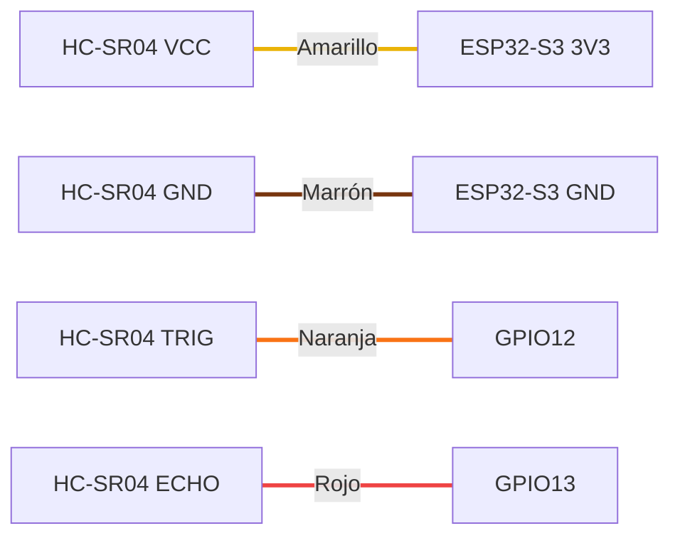

# Hardware

> **Migración (v4.1):** el origen de datos es ahora la **ESP32-S3 N16R8**. La ESP32-CAM AI Thinker ya no se usa. Ver [migracion-esp32-s3.md](migracion-esp32-s3.md).

## 1. Lista de materiales

| # | Componente | Cantidad | Descripción |
|---|-----------|----------|-------------|
| 1 | ESP32-S3 N16R8 (DevKitC-1 compatible) | 1 | SoC ESP32-S3 dual core 240 MHz, WiFi 2.4 GHz, BLE 5, **16 MB flash**, **8 MB PSRAM octal**. Dos USB-C: **COM** (CH343) y **USB** nativo. |
| 2 | Placa de expansión ESP32-S3 | 1 | Por cada GPIO ofrece una fila **negra (GND) / roja (VCC) / amarilla (señal)**. |
| 3 | HC-SR04 | 1 | Sensor ultrasónico, rango 2–400 cm, resolución ~0.3 cm, ángulo ~15°. |
| 4 | Cables Dupont | 4 | Amarillo, marrón, naranja, rojo. |
| 5 | Cable USB-C de **datos** | 1 | Los cables solo de carga no permiten programar. |
| 6 | Red WiFi 2.4 GHz | — | El ESP32 no soporta redes de 5 GHz. |

## 2. Conexiones

| HC-SR04 | ESP32-S3 N16R8 | Color | Dirección |
|---------|----------------|-------|-----------|
| VCC | 3V3 | 🟡 Amarillo | Alimentación |
| GND | GND | 🟤 Marrón | Tierra común |
| TRIG | GPIO12 | 🟠 Naranja | ESP32 → Sensor |
| ECHO | GPIO13 | 🔴 Rojo | Sensor → ESP32 |



> En la placa de expansión, TRIG y ECHO van en la **columna amarilla (señal)** de IO12 e IO13; la hilera amarilla larga junto al módulo replica los mismos pines y también es válida. **Nunca** conecte una señal a la columna roja (VCC).

Diagrama completo: [../diagrams/03-conexion-hardware.md](../diagrams/03-conexion-hardware.md).

## 3. Pines de la ESP32-S3 N16R8

| GPIO | Uso en el proyecto | Observación |
|------|--------------------|-------------|
| GPIO12 | TRIG | GPIO de uso general. |
| GPIO13 | ECHO | GPIO de uso general. |
| GPIO0, 3, 45, 46 | — | *Strapping pins*: evitar. |
| GPIO19 / 20 | — | USB nativo. |
| GPIO26–32 | — | Flash SPI (no disponibles). |
| GPIO35–37 | — | PSRAM octal en la variante **R8** (no disponibles). |
| GPIO43 / 44 | — | UART0 (TX/RX) hacia el CH343 del conector COM. |

## 4. Consideraciones eléctricas

### 4.1 Nivel lógico de ECHO

Los GPIO de la ESP32-S3 admiten **3.3 V máximo** (no toleran 5 V). Con el HC-SR04 alimentado a **3V3**, ECHO entrega ≤ 3.3 V y se conecta **directamente** a GPIO13. Verificado en hardware: lecturas estables de 166.6 cm.

Si su módulo HC-SR04 no responde a 3V3 (el monitor muestra `Sin eco del sensor` con el cableado correcto), es una variante solo de 5 V: aliméntelo desde **5V** y añada un divisor en ECHO:

```
HC-SR04 ECHO ──[ 1 kΩ ]──┬──► GPIO13
                         │
                      [ 2 kΩ ]
                         │
                        GND
```

V<sub>GPIO</sub> = 5 V × 2 kΩ / (1 kΩ + 2 kΩ) ≈ **3.33 V**. Alternativas: conversor de nivel (BSS138) o sensor HC-SR04P / RCWL-9610 (3–5.5 V).

### 4.2 Alimentación

- La ESP32-S3 requiere picos de ~350 mA al transmitir por WiFi. Use un puerto USB capaz de entregar al menos 500 mA.
- Si aparece `Brownout detector was triggered`, use otra fuente o un cable USB-C más corto/grueso.

### 4.3 Programación

1. Conecte el cable USB-C de datos al conector **COM** (chip CH343; en Windows aparece como `Dispositivo serie USB`, p. ej. COM7).
2. Arduino IDE → **ESP32S3 Dev Module**, *Flash Size* 16MB, *PSRAM* OPI, *USB CDC On Boot* **Disabled** (para ver el monitor serie por el conector COM).
3. Si la carga se queda en `Connecting...` o `Running stub flasher...`: desconecte y reconecte el USB-C. Si persiste: mantenga **BOOT**, pulse y suelte **RST**, suelte **BOOT**, o cargue con `esptool --no-stub` (ver [migracion-esp32-s3.md](migracion-esp32-s3.md#7-notas-de-carga-placas-esp32-s3-con-ch343)).
## 5. Principio de medición

```
distancia (cm) = tiempo_eco (µs) × 0.0343 (cm/µs) / 2
```

- 0.0343 cm/µs = velocidad del sonido a ~20 °C.
- Se divide entre 2 porque el sonido recorre ida y vuelta.
- La velocidad varía ~0.6 m/s por °C; para mayor precisión puede añadirse un sensor de temperatura (roadmap).

## 6. Expansión futura del hardware

| Componente | Pin sugerido | Notas |
|-----------|--------------|-------|
| Servo SG90 | GPIO15 (PWM, LEDC) | Alimentar desde 5V externo con GND común; picos de ~250 mA. |
| Cámara | — | La ESP32-S3 N16R8 no integra cámara; la vigilancia visual la aporta la cámara PTZ Tuya. |
| LED RGB | GPIO48 o GPIO38 (según la revisión de la placa) | Integrado; no lo usa el firmware. |