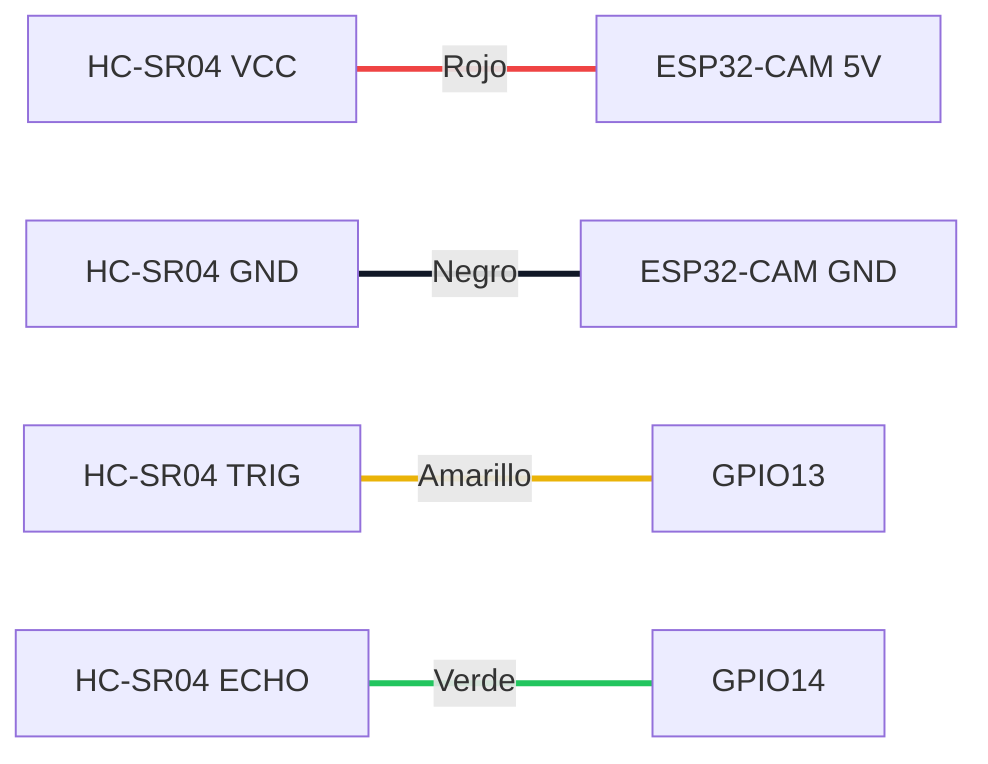

# Hardware

## 1. Lista de materiales

| # | Componente | Cantidad | Descripción |
|---|-----------|----------|-------------|
| 1 | ESP32-CAM AI Thinker | 1 | SoC ESP32 dual core 240 MHz, WiFi 2.4 GHz, Bluetooth, cámara OV2640, 4 MB PSRAM. |
| 2 | ESP32-CAM-MB | 1 | Placa programadora con conversor USB-serie CH340 y botón IO0/RESET. |
| 3 | HC-SR04 | 1 | Sensor ultrasónico, rango 2–400 cm, resolución ~0.3 cm, ángulo ~15°. |
| 4 | Cables Dupont | 4 | Rojo, negro, amarillo, verde. |
| 5 | Cable Micro-USB de **datos** | 1 | Los cables solo de carga no permiten programar. |
| 6 | Red WiFi 2.4 GHz | — | El ESP32 no soporta redes de 5 GHz. |

## 2. Conexiones

| HC-SR04 | ESP32-CAM | Color | Dirección |
|---------|-----------|-------|-----------|
| VCC | 5V | 🔴 Rojo | Alimentación |
| GND | GND | ⚫ Negro | Tierra común |
| TRIG | GPIO13 | 🟡 Amarillo | ESP32 → Sensor |
| ECHO | GPIO14 | 🟢 Verde | Sensor → ESP32 |



Diagrama completo: [../diagrams/03-conexion-hardware.md](../diagrams/03-conexion-hardware.md).

## 3. Pinout relevante de la ESP32-CAM AI Thinker

```
                 ┌───────────────────────┐
           5V  ──┤ ●                   ● ├── 3V3
          GND  ──┤ ●                   ● ├── GPIO16 (PSRAM)
        GPIO12 ──┤ ●                   ● ├── GPIO0  (BOOT)
   ▶    GPIO13 ──┤ ●   ESP32-CAM       ● ├── GND
   ▶    GPIO15 ──┤ ●   AI Thinker      ● ├── VCC (3.3/5V out)
   ▶    GPIO14 ──┤ ●                   ● ├── GPIO3  (U0RXD)
         GPIO2 ──┤ ●                   ● ├── GPIO1  (U0TXD)
         GPIO4 ──┤ ● (LED flash)       ● ├── GND
                 └───────────────────────┘
   ▶ = pines usados en este proyecto: GPIO13 (TRIG) y GPIO14 (ECHO)
```

> GPIO12–15 y GPIO2/4 son compartidos con la ranura microSD. **No use la tarjeta SD** mientras el HC-SR04 esté conectado a GPIO13/14, o reasigne pines.

## 4. Consideraciones eléctricas

### 4.1 Nivel lógico de ECHO (importante)

El HC-SR04 alimentado a 5 V devuelve un pulso de **5 V** en ECHO, mientras que los GPIO del ESP32 están especificados para **3.3 V** máximo. La conexión directa suele funcionar en la práctica, pero opera fuera de especificación y puede degradar el pin a largo plazo.

**Recomendación:** añadir un divisor resistivo en la línea ECHO:

```
HC-SR04 ECHO ──[ 1 kΩ ]──┬──► GPIO14
                         │
                      [ 2 kΩ ]
                         │
                        GND
```

V<sub>GPIO</sub> = 5 V × 2 kΩ / (1 kΩ + 2 kΩ) ≈ **3.33 V**.

Alternativas: conversor de nivel bidireccional (BSS138) o sensor compatible con 3.3 V (HC-SR04P, RCWL-1601).

### 4.2 Alimentación

- La ESP32-CAM requiere picos de hasta **~310 mA** al transmitir por WiFi (más con la cámara activa). Use un puerto USB capaz de entregar al menos 500 mA.
- Si aparecen mensajes `Brownout detector was triggered`, use otra fuente o un cable USB más corto/grueso.

### 4.3 Programación con ESP32-CAM-MB

1. Inserte la ESP32-CAM en la placa MB (antena hacia afuera del conector USB).
2. Conecte el cable Micro-USB de datos al PC.
3. Si el IDE no entra en modo de carga automáticamente: mantenga **IO0**, pulse y suelte **RST**, suelte **IO0**.
4. Tras subir el firmware pulse **RST** para ejecutar.

## 5. Principio de medición

```
distancia (cm) = tiempo_eco (µs) × 0.0343 (cm/µs) / 2
```

- 0.0343 cm/µs = velocidad del sonido a ~20 °C.
- Se divide entre 2 porque el sonido recorre ida y vuelta.
- La velocidad varía ~0.6 m/s por °C; para mayor precisión puede añadirse un sensor de temperatura (roadmap).

## 6. Expansión futura del hardware

| Componente | Pin sugerido | Notas |
|-----------|--------------|-------|
| Servo SG90 | GPIO15 (PWM, LEDC) | Alimentar desde 5V externo con GND común; picos de ~250 mA. |
| Cámara OV2640 | Bus interno | Ya integrada en la ESP32-CAM; requiere PSRAM. |
| LED flash | GPIO4 | Integrado; el firmware lo mantiene apagado. |
