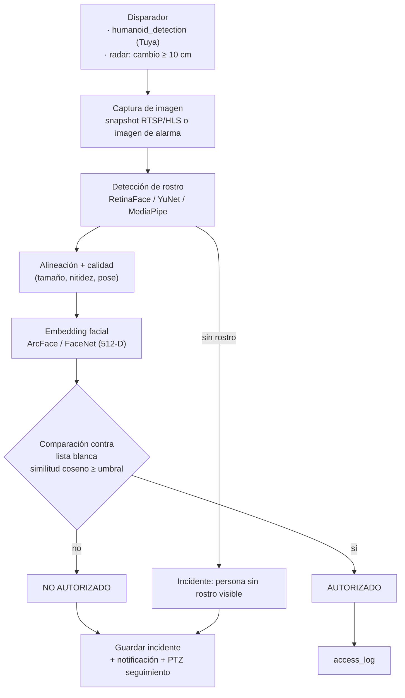
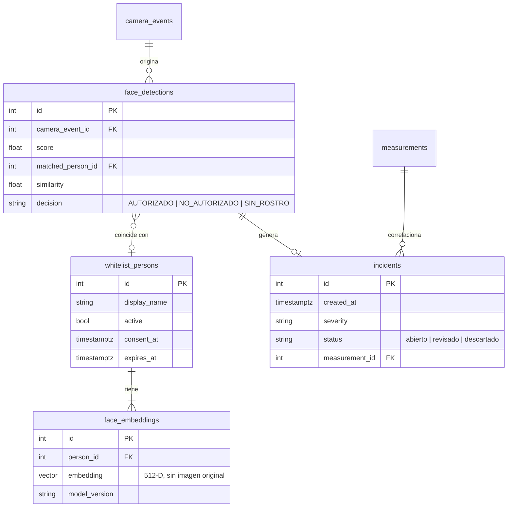

# Reconocimiento facial futuro (diseño)

> **Estado:** solo diseño. La versión actual **no** implementa biometría ni almacena rostros.
> Este documento fija la arquitectura, el modelo de datos y las salvaguardas para una iteración
> posterior.

## 1. Flujo

## 2. Componentes propuestos

| Capa | Opción recomendada | Alternativas |
|------|--------------------|--------------|
| Captura | `CameraService.snapshot()` (ya implementado; requiere Live Stream o imágenes de alarma) | ESP32-CAM OV2640 |
| Detección | **YuNet** (OpenCV, CPU, ligero) | RetinaFace, MediaPipe Face Detection, MTCNN |
| Embeddings | **ArcFace** (InsightFace `buffalo_l`, ONNX Runtime) | FaceNet, Hugging Face Inference API |
| Búsqueda | PostgreSQL + **pgvector** (`vector(512)`, índice HNSW) | FAISS en memoria |
| Ejecución | Worker asíncrono (cola `arq`/Celery) separado de la API | Endpoint síncrono para pruebas |
| Antispoofing | Modelo de *liveness* (Silent-Face) o correlación con el radar (distancia real > 0) | — |

## 3. Modelo de datos (borrador)

## 4. Endpoints futuros

| Método | Ruta | Descripción |
|--------|------|-------------|
| `POST` | `/api/faces/whitelist` | Alta con consentimiento (genera embedding; **no** guarda la foto) |
| `DELETE` | `/api/faces/whitelist/{id}` | Baja y borrado de embeddings (derecho de supresión) |
| `POST` | `/api/faces/verify` | Verifica una imagen → `AUTORIZADO`/`NO AUTORIZADO` |
| `GET` | `/api/incidents` | Incidentes con filtros |

## 5. Decisión y umbrales

* Similitud coseno con ArcFace: umbral inicial **0.45–0.50**, a calibrar con un conjunto propio
  (curva ROC, objetivo FAR ≤ 1 %).
* Exigir **N ≥ 2 fotogramas** concordantes antes de declarar "NO AUTORIZADO" para reducir falsos positivos.
* Registrar `model_version` para poder reprocesar si cambia el modelo.

## 6. Privacidad y cumplimiento (obligatorio antes de implementar)

Los datos biométricos son **datos sensibles** (Ley 1581 de 2012 en Colombia, RGPD art. 9 en la UE):

* Consentimiento **explícito e informado** de cada persona de la lista blanca; aviso visible de videovigilancia.
* Guardar **solo embeddings**, nunca fotos de la lista blanca; cifrado en reposo (columna o disco).
* Retención limitada de imágenes de incidentes (p. ej. 30 días) y borrado automático.
* Acceso restringido (rol administrador) y registro de auditoría de cada consulta.
* Evaluación de impacto (DPIA) y revisión de sesgos del modelo antes del despliegue.
* Prohibido el uso con personas ajenas a la lista blanca más allá de la decisión "no autorizado".

## 7. Plan por fases

| Fase | Entregable |
|------|-----------|
| IA-1 | Habilitar Live Stream y snapshot fiable (prerrequisito) |
| IA-2 | Detección de rostros (sin identificación) sobre eventos `humanoid_detection` |
| IA-3 | Lista blanca + embeddings + pgvector + `/api/faces/verify` |
| IA-4 | Incidentes, notificaciones (Telegram/correo) y seguimiento PTZ |
| IA-5 | Fusión radar + cámara (confirmar presencia física, antispoofing) |
