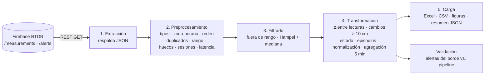

# Procesamiento de datos

Pipeline ETL en Python ([`pipeline.py`](pipeline.py)) que toma las lecturas guardadas en Firebase Realtime Database y las deja listas para análisis y toma de decisiones.



## Uso

```bash
pip install -r processing/requirements.txt
python processing/pipeline.py                                   # descarga de Firebase y procesa
python processing/pipeline.py --input processing/output/respaldo_firebase.json   # reprocesa un respaldo
python -m pytest -q processing                                  # pruebas
```

Los resultados quedan en `processing/output/`.

| Archivo | Contenido |
|---------|-----------|
| `respaldo_firebase.json` | Copia exacta de `/measurements` y `/alerts` en el momento del procesamiento. |
| `lecturas_procesadas.csv` | Una fila por lectura con distancia cruda, filtrada y normalizada, variación, evento, estado, pico, sesión y latencia. |
| `datos_procesados.xlsx` | Hojas *Lecturas*, *Cambios*, *Episodios*, *Agregado_5min*, *Calidad* y *Parametros*. |
| `resumen.json` | Indicadores de calidad y contraste de alertas. |
| `fig_*.png` | Serie cruda vs. filtrada con cambios, distribución y latencia, agregación cada 5 min. |

## Operaciones

| Etapa | Operación | Justificación |
|-------|-----------|---------------|
| Preprocesamiento | Conversión de tipos, `epoch` → hora de Bogotá, orden cronológico y eliminación de duplicados por `epoch` | Firebase devuelve un objeto JSON sin orden garantizado y con valores tipados de forma laxa. |
| | Validación de rango 2–400 cm | Rango útil del HC-SR04 según su hoja de datos; fuera de él la lectura no es confiable. |
| | Huecos (Δt > 45 s) y lecturas perdidas | Mide la completitud de la transmisión frente al periodo de 30 s. |
| | Sesiones (pausa > 10 min) | Evita comparar lecturas de encendidos distintos. |
| | Latencia (`received_at` − `epoch`) | Tiempo entre la lectura en la ESP32 y su escritura en Firebase. |
| Filtrado | Filtro de **Hampel** (ventana 5, k = 3, MAD mínima 1 cm) con reemplazo por la mediana local | Elimina picos aislados (un objeto que pasa durante una sola lectura) sin suavizar los escalones reales ni el ruido normal (±0,5 cm). |
| Transformación | Variación `Δ = d(t) − d(t−1)` y eventos `|Δ| ≥ 10 cm` | Misma regla que el firmware: permite **validar** las alertas del borde y recalcularlas sobre el histórico previo a la v3. |
| | Estado *objeto cercano* / *libre* (umbral 100 cm) | La distribución es bimodal (≈ 4 cm y ≈ 214 cm); el umbral separa ambos modos. |
| | Episodios (tramos con el mismo estado) | Convierte la serie en eventos con inicio, fin y duración, útiles para decidir. |
| | Normalización min-max al rango del sensor | Deja la variable en [0, 1] para futuros modelos de aprendizaje automático. |
| | Agregación cada 5 min (media, mín., máx., cambios, % de ocupación) | Reduce el volumen y resume el comportamiento para el tablero y los informes. |

Los parámetros están en la clase `Config` de [`pipeline.py`](pipeline.py).
